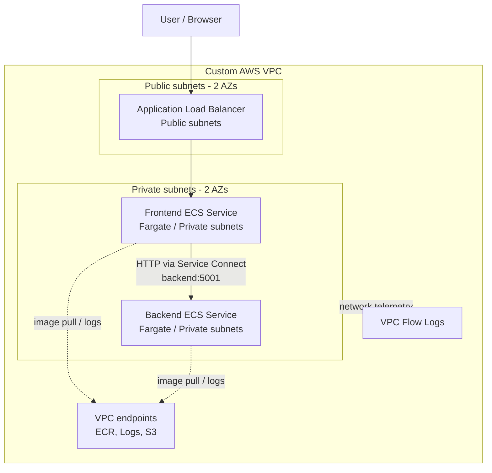

# Containerized Application Deployment on AWS ECS Fargate

A portfolio project demonstrating how a small containerized web application can be run locally with Docker and described as reproducible AWS infrastructure using Terraform.

> **Deployment status:** This repository is designed to be demonstrable locally. The AWS infrastructure is provided as Terraform configuration, but this repository does not claim that AWS resources are currently deployed or running. No AWS account or paid resources are required for the local demo.

## What this project demonstrates

- Containerizing a Python Flask application with Docker
- Separating a public-facing frontend service from an internal backend service
- ECS Fargate task and service definitions
- A custom VPC with public and private subnets across two Availability Zones
- An internet-facing Application Load Balancer (ALB)
- Private ECS tasks with no public IP addresses
- VPC endpoints for ECR, CloudWatch Logs, and S3 access without a NAT Gateway
- VPC Flow Logs for network visibility
- ECS Service Connect for internal service discovery
- Infrastructure as Code with reusable Terraform modules

## Architecture



## Repository layout

```text
.
├── app/
│   ├── app.py
│   └── requirements.txt
├── terraform/
│   ├── main.tf
│   ├── variables.tf
│   ├── outputs.tf
│   ├── versions.tf
│   └── modules/
│       ├── network/
│       └── application/
├── Dockerfile
├── .dockerignore
├── .gitignore
├── docker-compose.yml
└── docs/
    └── architecture.md
```

## Run locally (no AWS required)

Requirements: Docker Desktop or Docker Engine with the Compose plugin.

```bash
git clone https://github.com/<your-username>/ecs-fargate-container-platform.git
cd ecs-fargate-container-platform
docker compose up --build
```

Open:

- Frontend: http://localhost:8080
- Frontend health: http://localhost:8080/health
- Backend health (local demo only): http://localhost:5001/health

The frontend calls the backend over the Docker Compose network. This locally demonstrates the same service-to-service pattern that the AWS design uses with ECS Service Connect.

Stop the local containers:

```bash
docker compose down
```

## Terraform: inspect without deploying

Terraform configuration is under `terraform/`. To format and validate it:

```bash
cd terraform
terraform fmt -recursive
terraform init -backend=false
terraform validate
terraform plan
```

`terraform plan` requires AWS credentials and a configured AWS region to fully evaluate provider data. It does not create infrastructure. **Do not run `terraform apply` unless you intentionally want to create AWS resources and have reviewed the cost implications.**

The configuration expects pre-built container images in ECR. Build and push steps are intentionally not automated in this repository; set the image variables only when you decide to deploy.

## Infrastructure design

| Component | Purpose |
|---|---|
| VPC | Isolated network boundary |
| Public subnets | Host the internet-facing ALB |
| Private subnets | Run ECS tasks without public IPs |
| ALB | Public HTTP entry point and traffic distribution |
| ECS Fargate | Serverless container compute |
| ECR | Container image registry (image URIs supplied as variables) |
| Interface VPC endpoints | Private access to ECR API, ECR Docker, and CloudWatch Logs |
| S3 gateway endpoint | Private access to S3, including image-layer retrieval |
| VPC Flow Logs | Capture VPC network-flow metadata |
| ECS Service Connect | Internal discovery and communication between frontend and backend |

## Security notes

- ECS tasks are placed in private subnets and do not receive public IP addresses.
- The ALB security group accepts HTTP from the internet; the frontend task security group accepts application traffic only from the ALB security group.
- The backend task security group accepts backend traffic only from the frontend task security group.
- The backend is not registered with the public ALB.
- The Terraform configuration creates a CloudWatch log group with a retention period.
- This is a learning project, not a production security baseline. Add HTTPS, WAF, stronger secrets handling, image scanning, alarms, and stricter egress controls before production use.

## Current limitations / honest project status

- The app can be demonstrated locally using Docker Compose.
- Terraform describes the AWS infrastructure; it is not proof of a successful AWS deployment.
- No live endpoint is provided because AWS resources are not being kept running.
- VPC endpoints reduce reliance on a NAT Gateway, but interface endpoints have hourly and data-processing charges when deployed.
- Review the Terraform plan and AWS pricing before creating any resources.

## Suggested demo flow

1. Show the architecture diagram in `docs/architecture.md`.
2. Run `docker compose up --build`.
3. Open the frontend page and show the backend response.
4. Show the `/health` endpoints.
5. Walk through the Terraform modules: networking, security groups, ALB, ECS services, Service Connect, endpoints, and Flow Logs.
6. Explain that the AWS deployment is intentionally stopped/not active; the repository preserves the implementation and design for review.

## License

MIT. See `LICENSE`.
